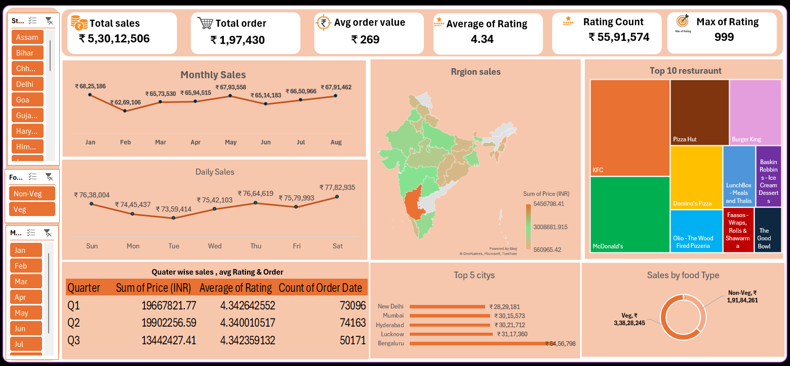

# 📊 Restaurant Sales Analysis Dashboard | Excel

An interactive Excel dashboard created to analyze restaurant sales,
orders, ratings, food types, regions, cities, and restaurant performance.

## 📌 Project Overview

This project transforms restaurant sales data into an interactive
dashboard to identify sales trends, regional performance, top restaurants,
food-type performance, and customer rating patterns.

## 🔍 Dashboard KPIs

- Total Sales: ₹5,30,12,506
- Total Orders: ₹1,97,430
- Average Order Value: ₹269
- Average Rating: 4.34
- Rating Count: 55,91,574
- Maximum Rating: 999

## 📈 Dashboard Analysis

The dashboard includes:

- Monthly Sales Analysis
- Daily Sales Analysis
- Region-wise Sales
- Top 10 Restaurants
- Top 5 Cities by Sales
- Sales by Food Type
- Quarter-wise Sales
- Average Rating Analysis
- Order Count Analysis

## 🛠️ Tools Used

- Microsoft Excel
- Pivot Tables
- Pivot Charts
- Slicers
- Data Cleaning
- Dashboard Design

## 💡 Key Insights

- Sales performance can be compared across different months.
- Regional analysis helps identify areas with higher sales.
- The Top 10 Restaurants section highlights major restaurant contributors.
- City-wise analysis shows the highest-performing locations.
- Food-type analysis compares Veg and Non-Veg sales.
- Quarterly analysis combines sales, ratings, and order information.

## 📷 Dashboard Preview

